# 1. Instalação da Extensão MetaMask

Acesse o portal oficial:

```text
https://metamask.com/pt-BR

```

Selecione o navegador de sua preferência (ex: **Chrome**) e clique em **Add Extension** (Adicionar ao Chrome).

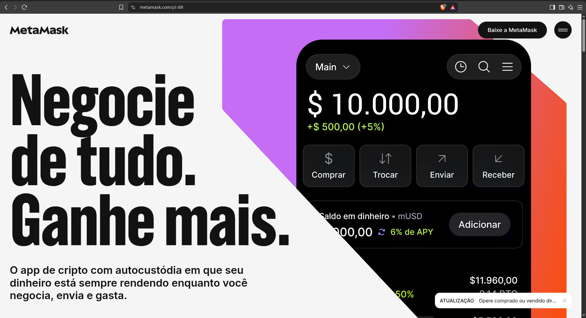
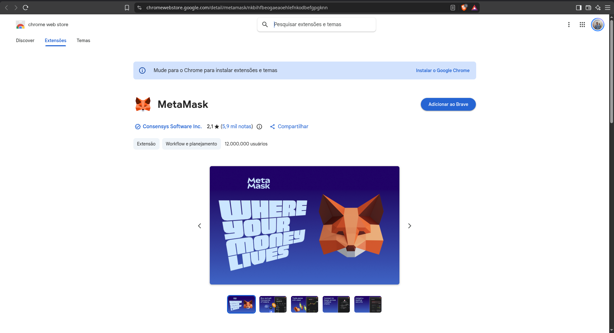

---

# 2. Configurar a Carteira

Ao inicializar a extensão pela primeira vez, escolha entre criar um novo cofre de chaves ou importar uma carteira preexistente:

* **Criar uma nova carteira**: gera uma nova seed phrase (frase de recuperação);
* **Importar uma carteira existente**: restaura o acesso via seed phrase prévia.

### 2.1 Criar uma nova carteira

* Clique em **Criar uma Nova Carteira**;
* Defina uma senha local de acesso;
* Realize o backup da sua frase de recuperação em local seguro.
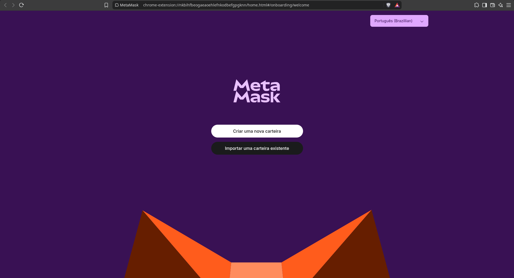

---

# 3. Importar Conta de Teste via Chave Privada

No menu de gerenciamento de contas da MetaMask, navegue até:

```text
Contas → Importar Conta

```

Selecione o tipo de importação como **Chave Privada** e insira uma das chaves privadas disponíveis em genesis.json -> alloc[]. Exemplo:

```text
0x8f2a55949038a9610f50fb23b5883af3b4ecb3c3bb792cbcefbd1542c692be63

```

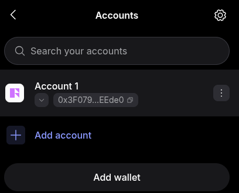
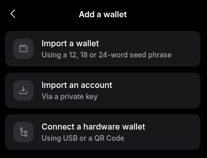

---

# 4. Adicionar a Rede Hyperledger Besu

Para integrar a carteira à blockchain privada local, cadastre manualmente os parâmetros de rede:

| Parâmetro | Valor Configurado |
| --- | --- |
| **Nome da Rede** | `localhost 8545` |
| **RPC URL** | `http://localhost:8545` |
| **Chain ID** | `1337` |
| **Símbolo de Moeda** | `ETH` |

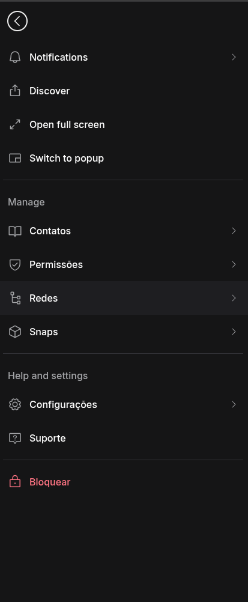
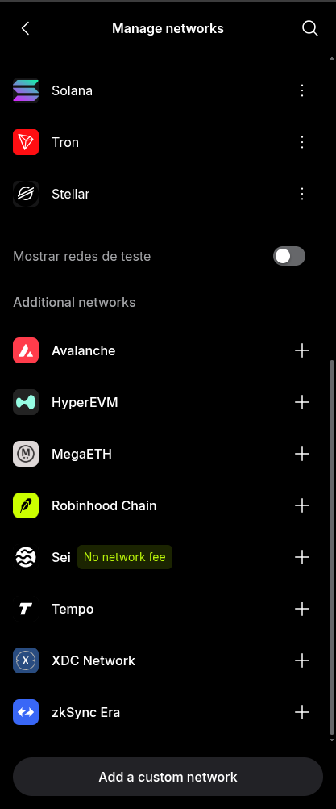
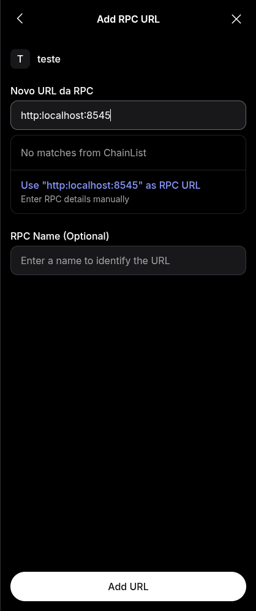
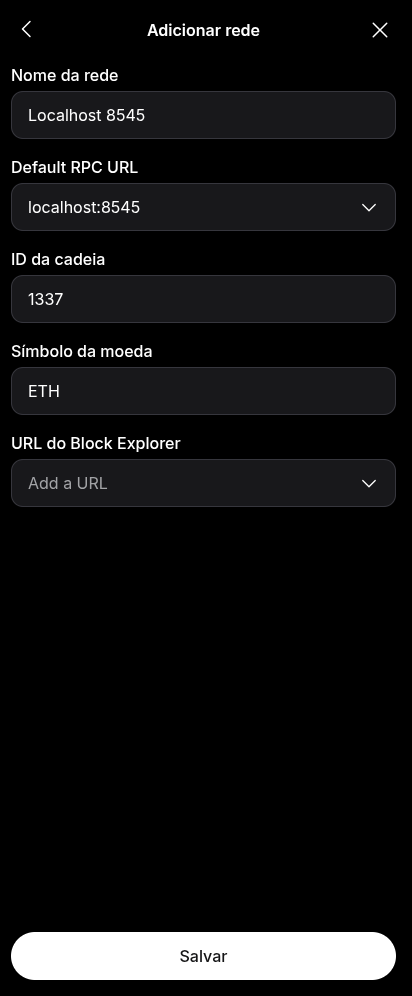

---

## 4.1 Validação de Conectividade do Endpoint RPC

Caso a MetaMask não consiga estabelecer conexão com a rede Besu, valide a disponibilidade do endpoint RPC executando as chamadas JSON-RPC abaixo.

Para testar a partir do terminal da máquina virtual (onde o nó está executando):

> [!IMPORTANT]
> EXECUTE A VALIDAÇÃO ABAIXO:

```bash
curl -s -X POST \
  -H "Content-Type: application/json" \
  -d '{"jsonrpc":"2.0","method":"web3_clientVersion","params":[],"id":1}' \
  http://localhost:8545 | jq .

```

Para validar a comunicação a partir do host físico (fora da VM/Vagrant):

> [!IMPORTANT]
> EXECUTE A VALIDAÇÃO ABAIXO:

```bash
curl -s -X POST \
  -H "Content-Type: application/json" \
  -d '{"jsonrpc":"2.0","method":"web3_clientVersion","params":[],"id":1}' \
  http://localhost:8545 | jq .
```

---

# 5. Conectar-se à Rede e Consultar Saldo

### 5.1 Selecionar a rede local

No seletor de redes no topo da interface da MetaMask, selecione a rede recém-configurada:

```text
MetaMask → Selecionar Rede → localhost 8545

```

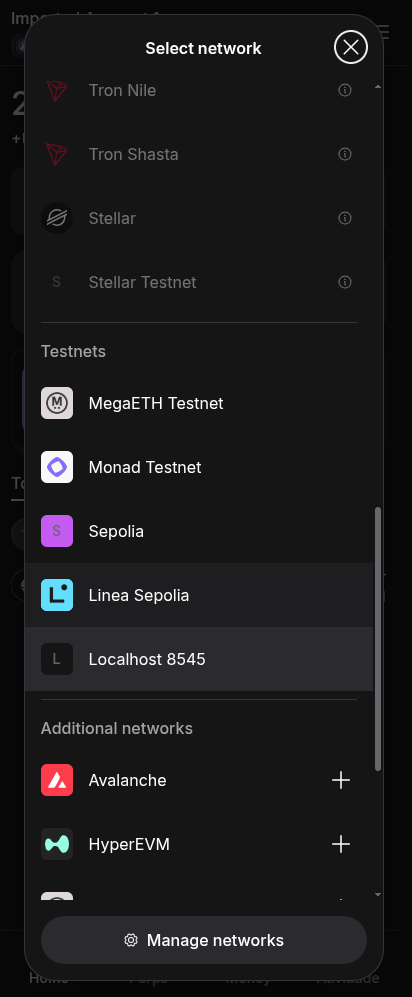

### 5.2 Validação do saldo

Com a rede ativa, o saldo da conta importada será atualizado e exibido no painel principal.

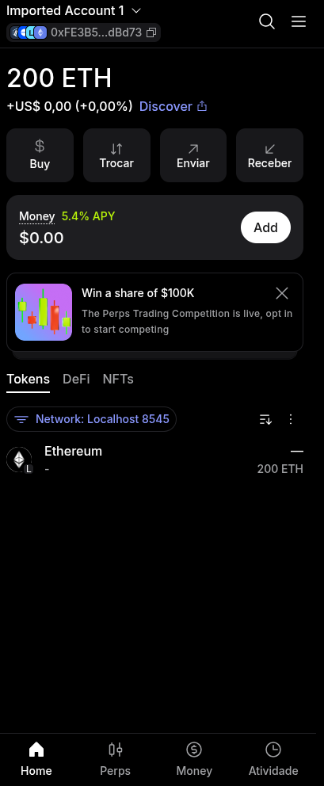

Para confirmar o saldo via terminal utilizando chamada JSON-RPC direta ao nó:

> [!IMPORTANT]
> EXECUTE A VALIDAÇÃO ABAIXO:

```bash
curl -s -X POST \
  -H "Content-Type: application/json" \
  -d '{"jsonrpc":"2.0","method":"eth_getBalance","params":["0xfe3b557e8fb62b89f4916b721be55ceb828dbd73", "latest"],"id":1}' \
  http://localhost:8545 | jq .

```

---
# 6. Realizar Transações

Importe uma segunda conta no ambiente para executar uma transação completa entre nós locais.

### 6.1 Importação da Conta Secundária

Utilize o fluxo da **Seção 3** informando outra chave privada do arquivo genesis.json.

### 6.2 Submeter transferência

1. Clique no botão **Enviar**;
2. Cole o endereço Ethereum de destino;
3. Informe a quantidade de **ETH** a ser transferida;
4. Revise os parâmetros de taxa (gas) e confirme o envio.

> [!WARNING]
> Os tokens ETH utilizados neste ambiente destinam-se exclusivamente para fins educacionais e testes em rede de desenvolvimento, sem valor comercial.

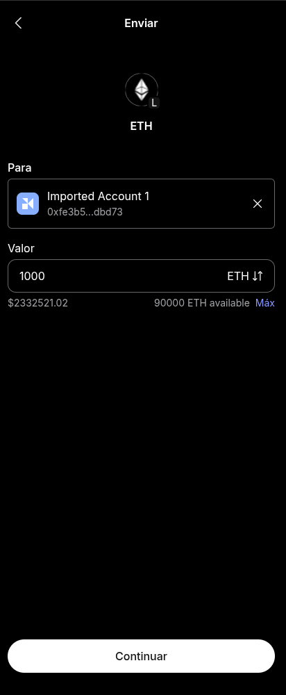

### 6.3 Monitorar o histórico de blocos e transações

Acompanhe as operações submetidas e o estado de confirmação através da aba de histórico da carteira.

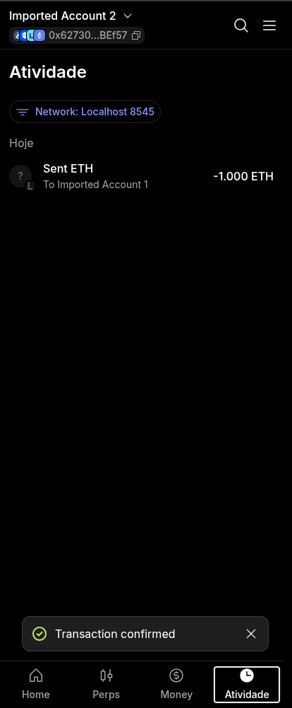

---

