# 1. Acessando o Remix IDE

Acesse o ambiente oficial do Remix via navegador:

```text
https://app.remix.live

```

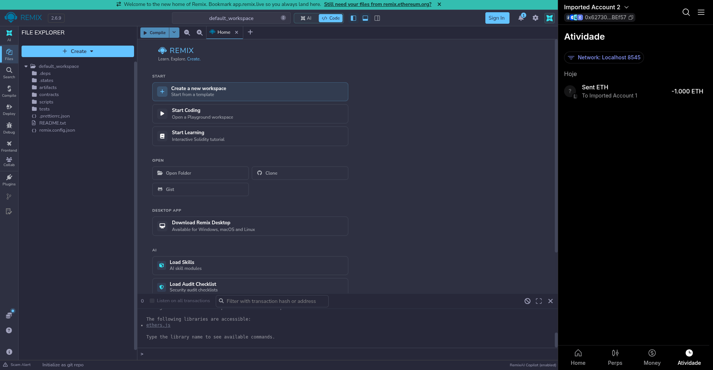

---

# 2. Conectar a Carteira MetaMask ao Remix

Nesta etapa, conecte o Remix IDE à extensão MetaMask utilizando uma das contas locais provisionadas no laboratório para autorizar o deploy de contratos e a assinatura de transações.

1. No Remix, acesse a aba de conexão de carteiras;
2. Selecione o provedor correspondente à **MetaMask**;
3. Na janela pop-up da extensão, autorize a conexão da conta com a aplicação.

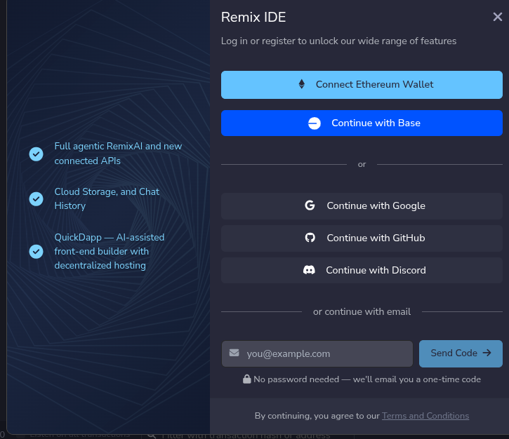
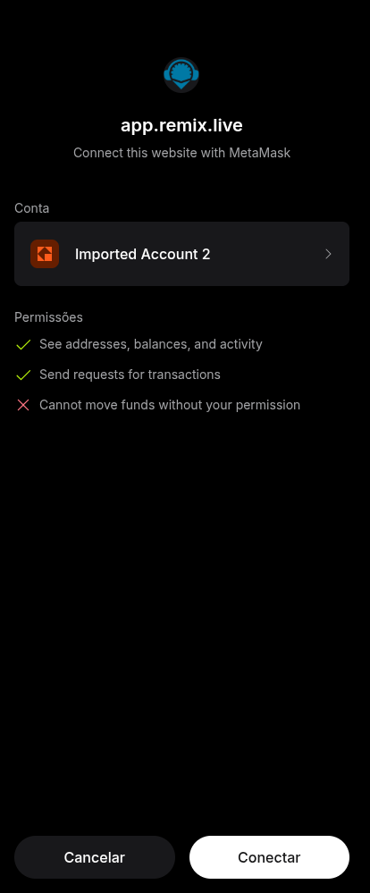
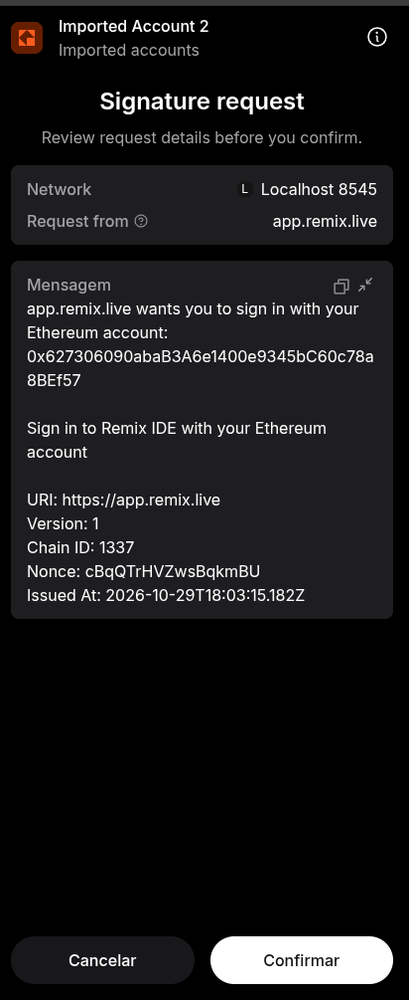

---

# 3. Carregar o Contrato de Exemplo

No gerenciador de arquivos do Remix (*File Explorer*), selecione o contrato de exemplo padrão `1_Storage.sol` dentro da pasta `contracts/`.

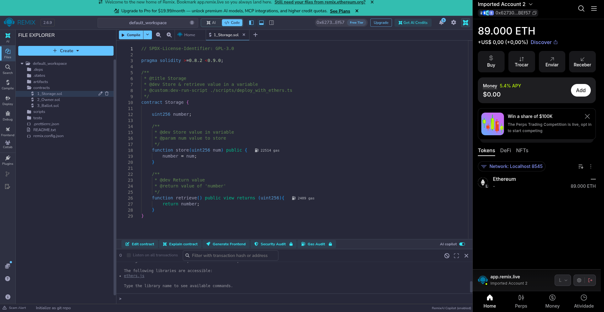

### 3.1 Código-fonte do Contrato (`Storage.sol`)

```solidity
// SPDX-License-Identifier: GPL-3.0

pragma solidity >=0.8.2 <0.9.0;

/**
 * @title Storage
 * @dev Store & retrieve value in a variable
 * @custom:dev-run-script ./scripts/deploy_with_ethers.ts
 */
contract Storage {

    uint256 number;

    /**
     * @dev Store value in variable
     * @param num value to store
     */
    function store(uint256 num) public {
        number = num;
    }

    /**
     * @dev Return value 
     * @return value of 'number'
     */
    function retrieve() public view returns (uint256){
        return number;
    }
}

```

---

# 4. Compilar o Contrato Inteligente

Acesse a aba **Solidity Compiler** no menu lateral esquerdo:

1. Selecione uma versão do compilador compatível com a diretiva `pragma` do contrato (ex: `0.8.26` ou qualquer release `>=0.8.2 <0.9.0`);
2. Selecione o arquivo `Storage.sol`;
3. Clique no botão **Compile Storage.sol**.

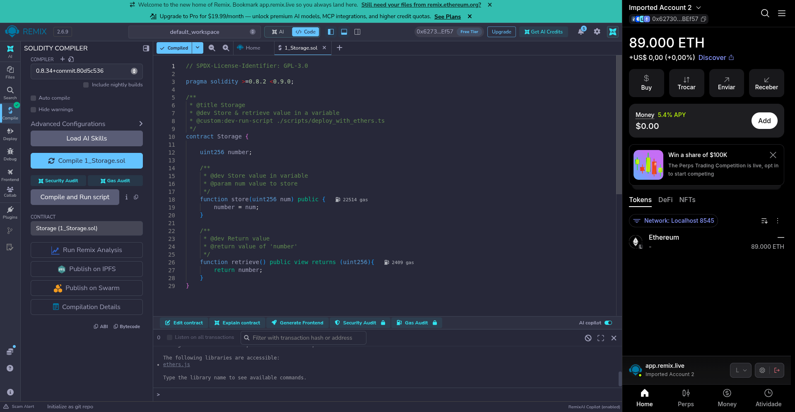

---

# 5. Realizar o Deploy na Rede Besu

Navegue até a aba **Deploy & Run Transactions** para publicar o contrato na blockchain local.

### 5.1 Parâmetros de Execução

* No campo **Environment**, altere de `Remix VM` para **Browser Extension - MetaMask**;
* No campo **Account**, valide o endereço da conta selecionada;
* Certifique-se de que o contrato `Storage` está selecionado no campo **Contract**;
* Clique em **Deploy**.

### 5.2 Confirmação na Extensão

Quando a janela da MetaMask abrir automaticamente:

* Revise os parâmetros de taxa e dados da transação;
* Clique em **Confirmar** para assinar e propagar a transação para o nó Besu.
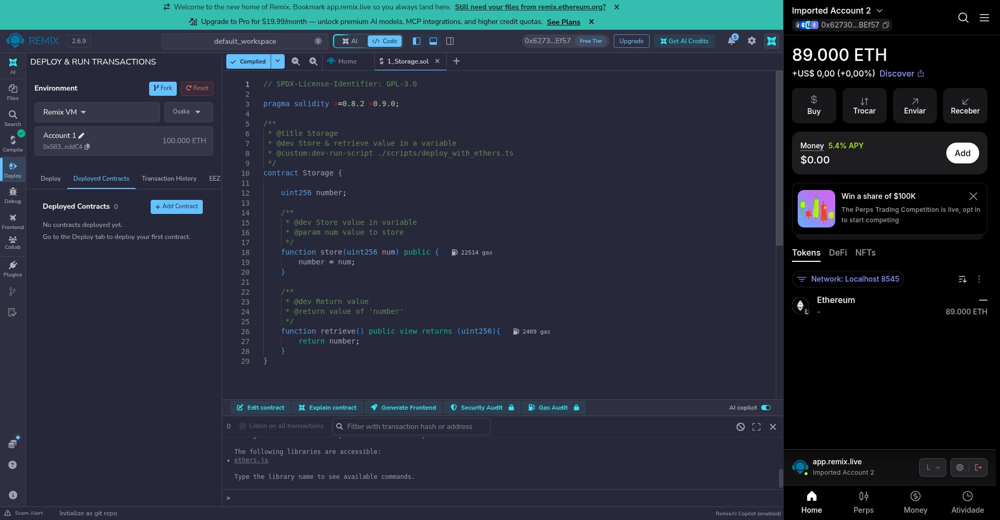
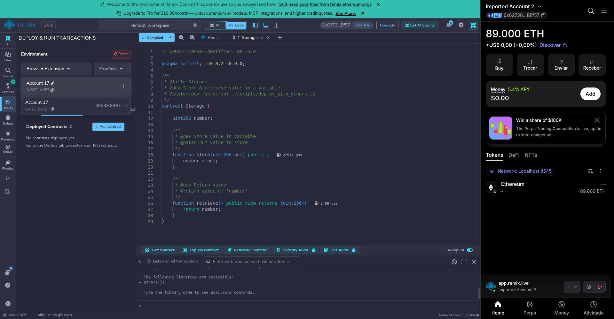
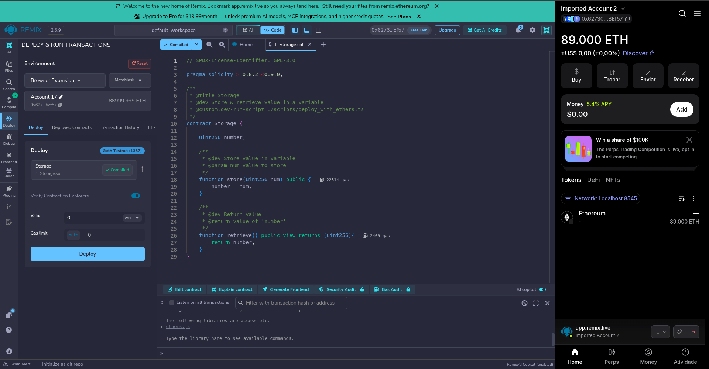
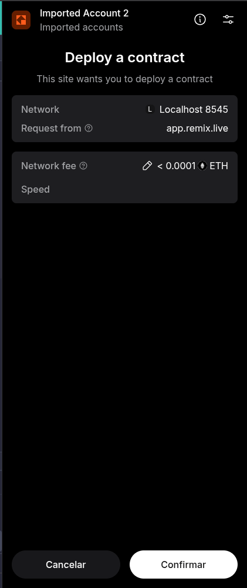
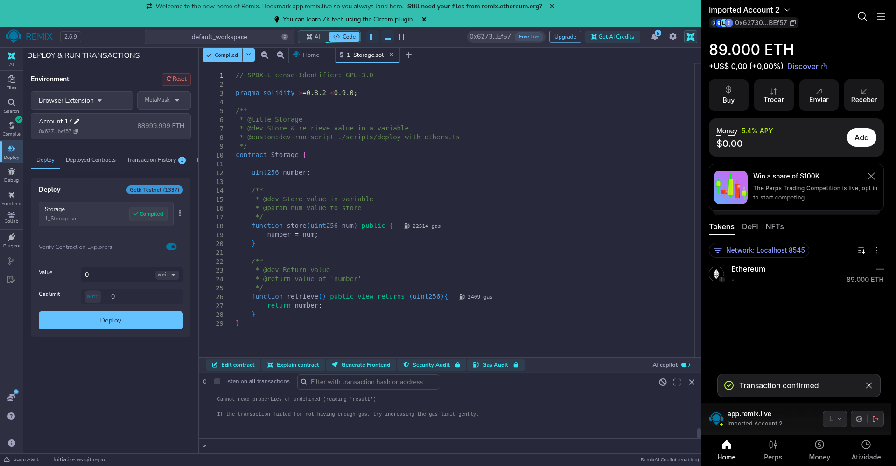

---

# 6. Interagindo com o Contrato Deployado

Após a confirmação do bloco, o contrato aparecerá na seção **Deployed Contracts** na parte inferior do painel lateral. Se não aparecer, copie o endereço do contrato nos detalhes da transação no console e registre manualmente.

1. Expanda a instância do contrato deployado ou utilize a opção *At Address* informando o endereço do contrato;
2. No método `store`, insira um valor inteiro (ex: `42`) e clique no botão para submeter a transação;
3. Confirme a transação na MetaMask;
4. Clique no método `retrieve` (chamada de leitura *view*, sem custo de gas) para verificar se o valor retornado corresponde ao armazenado.

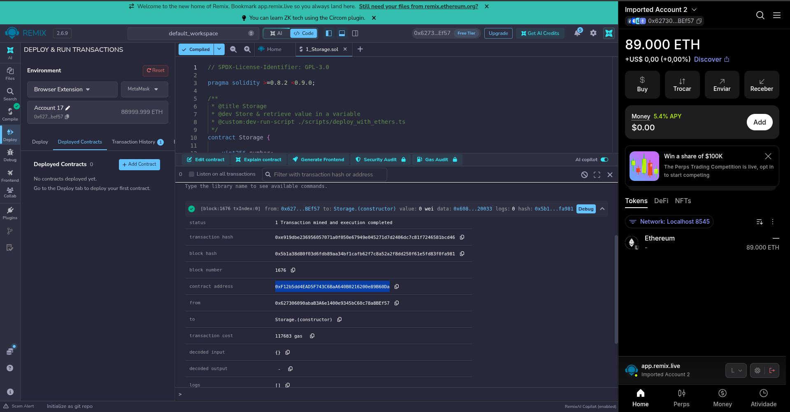
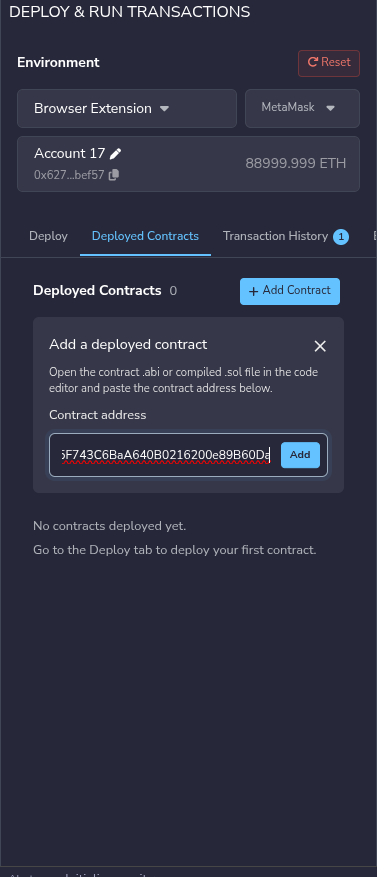
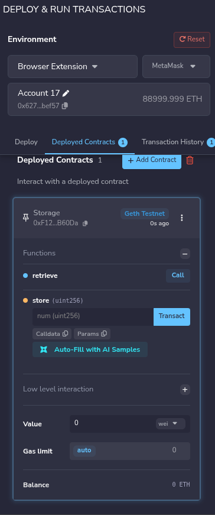
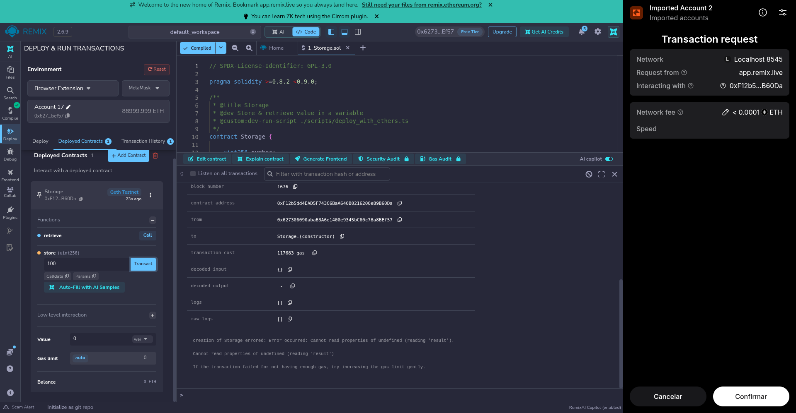
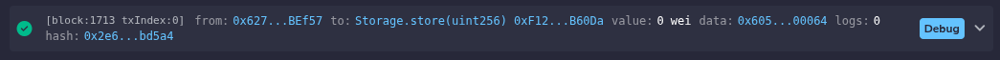

---

# 7. Validação nos Logs do Nó Besu

Para confirmar que a transação foi processada pelo consenso QBFT e registrada em um bloco da rede local, execute o monitoramento do contêiner `org1-node1` filtrando pelo hash do bloco gerado:

> [!IMPORTANT]
> EXECUTE A VALIDAÇÃO ABAIXO:

```bash
docker logs org1-node1 -f | grep <HASH_DO_BLOCO_OU_TRANSACAO>

```

Exemplo de retorno esperado indicando a importação do bloco com a transação incluída:

```text
2026-10-29 15:07:32.076-03:00 | BftProcessorExecutor-QBFT-0 | INFO  | QbftBesuControllerBuilder | Imported #1,713 / 1 tx / 1 pending / 43,718 (0.1%) gas / (0x2e6e37400de87847993bfff3f8ee224a39e5ef51acbfb32d4e8155687a8bd5a4)

```
